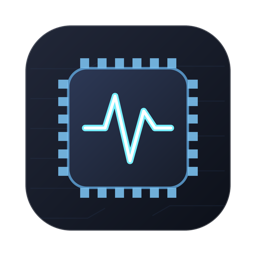
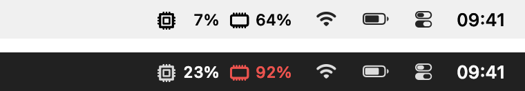
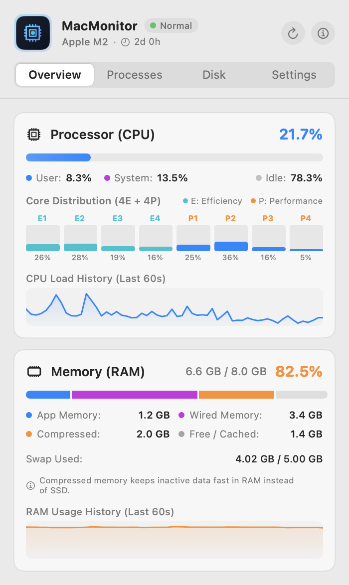
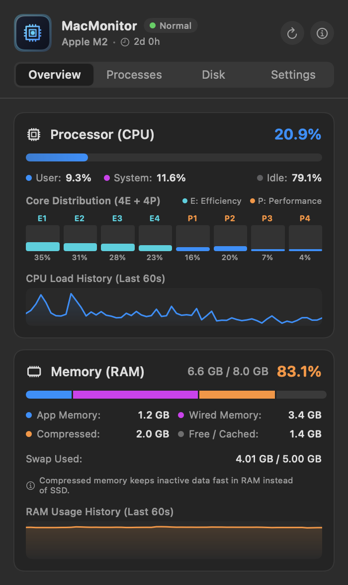
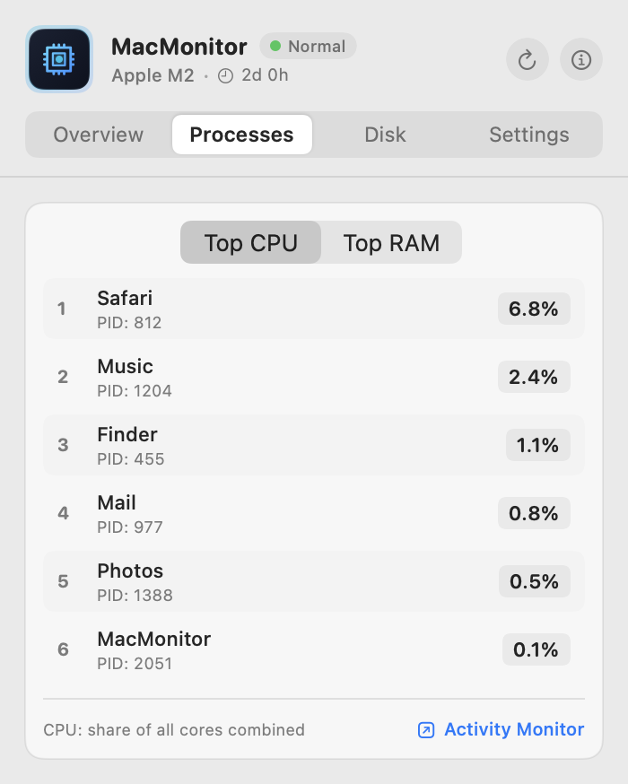
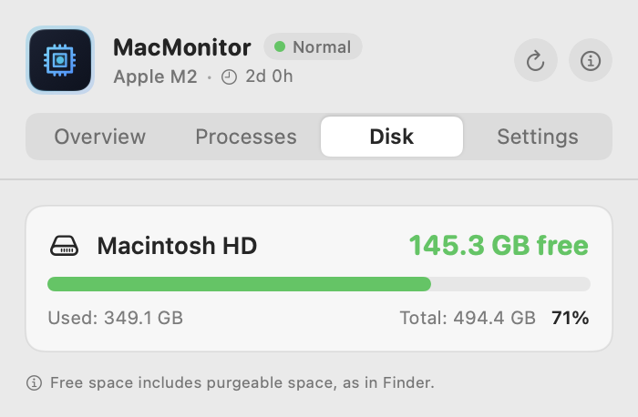

<p align="center">
  
</p>

<h1 align="center">MacMonitor</h1>

<p align="center">
  A native <b>menu bar monitor</b> for macOS: live <b>CPU</b> and <b>RAM</b> usage in the menu bar, with per-core load, memory breakdown, top processes and free disk space one click away.<br>
  Written in Swift with AppKit and SwiftUI; no Electron and no third-party libraries.
</p>

<p align="center">
  <b>🇬🇧 English</b> · <a href="README.tr.md">🇹🇷 Türkçe</a>
</p>

<p align="center">
  <a href="https://gitlab.com/freeware2/macmonitor/-/releases/permalink/latest/downloads/MacMonitor.pkg"></a>
</p>

<p align="center">
  <a href="https://gitlab.com/freeware2/macmonitor/-/releases">All releases</a> · <a href="#download-and-install">Installation steps</a> · The interface is in English and Turkish
</p>

> [!warning] The first time you open the installer, macOS blocks it. This is expected.
> MacMonitor is free and not notarized by Apple, so when you double-click the downloaded `MacMonitor-<version>.pkg` for the first time, macOS says it *could not verify* the package and does not open it. You only need to allow it once:
>
> 1. In the warning, click **Done**. Do **not** click *Move to Trash*.
> 2. Open **System Settings ▸ Privacy & Security** and scroll down to **Security**.
> 3. Next to *"MacMonitor-&lt;version&gt;.pkg" was blocked to protect your Mac*, click **Open Anyway** and confirm with your password or Touch ID. The installer opens.
>
> Prefer Terminal? Run `xattr -d com.apple.quarantine ~/Downloads/MacMonitor-*.pkg`, then double-click the package.

## Screenshots

The readout in light and dark menu bars (red once a threshold is crossed), and the panel that opens with a click.

<p align="center"></p>

<p align="center">
  
  &nbsp;
  
</p>

<p align="center">
  
  &nbsp;
  
</p>

## Features

### Menu bar

- **Live CPU and RAM percentages**, refreshed every 0.5 to 5 seconds.
- **Five styles:** symbols (`cpu 12%  ram 48%`), text (`CPU 12%  RAM 48%`), minimal (`12% · 48%`), CPU only or RAM only.
- **Alerts:** the value turns red when CPU or RAM crosses your threshold (20% to 95%; 85% for CPU and 90% for RAM by default).
- **Right-click menu:** refresh now, open Activity Monitor, quit.
- No Dock icon: MacMonitor lives only in the menu bar.

### Overview

- **CPU:** total usage split into user, system and idle, a bar for every core (efficiency and performance cores on Apple Silicon) and a 60-second history graph.
- **Memory:** used and total RAM, computed the same way as Activity Monitor and split into App, Wired, Compressed and Free/Cached, plus swap use and a 60-second history graph.
- The chip model and uptime in the header.

### Processes

- The six processes using the most **CPU** or **memory**, with name and PID.
- CPU is shown as a share of all cores, on the same scale as the menu bar total; memory is the physical footprint, as in Activity Monitor.
- Lists your own processes; system processes need administrator rights to read. A link opens Activity Monitor.

### Disk

- **Free, used and total space** for every mounted volume: the startup disk, external drives and USB sticks.
- Sizes as Finder shows them (decimal GB, purgeable space counted as free). The bar turns orange above 75% and red above 90%.
- Double-click a volume to open it in Finder.

### Light on resources

- About **0.1% of total CPU and 40 MB of memory** with the panel closed.
- Reads everything through Darwin and Mach APIs (`host_statistics64`, `host_processor_info`, `proc_pidinfo`, `sysctl`): no `top` or `ps` shell commands, so nothing fills up the system log.
- Processes are scanned only while the panel is open, and disks are read only while the Disk tab is open.

### Settings

- Refresh rate, menu bar style, alert thresholds and red highlighting, history graphs on or off.
- **English, Turkish or the system language**, switched without restarting.
- **Launch at login** through macOS `ServiceManagement` (`SMAppService`), on by default.

## Download and install

The package runs on Apple Silicon and Intel Macs; macOS 13 or later is required.

1. Download the installer with the [download button](https://gitlab.com/freeware2/macmonitor/-/releases/permalink/latest/downloads/MacMonitor.pkg) at the top, or pick a version on the [Releases](https://gitlab.com/freeware2/macmonitor/-/releases) page.
2. Double-click `MacMonitor-<version>.pkg`. **The first time, macOS blocks it:** follow the steps below once.
3. Click through the installer. MacMonitor is installed in **Applications**, opens by itself and its readout appears in the menu bar.
4. From then on MacMonitor starts whenever you log in. You can turn this off in its Settings (*Launch automatically at login*).

Prefer no installer? Each release also has a `MacMonitor-<version>.zip`: open it and drag `MacMonitor.app` to **Applications**.

### First launch: allow the installer once

> [!important] macOS blocks the installer the first time you open it. This is expected, not a fault.
> The package is not signed with an Apple developer ID and is not notarized by Apple, so macOS cannot verify it. Allow it once:
>
> 1. **Double-click the package.** macOS says Apple could not verify it and does not open it. Click **Done**. Do **not** click *Move to Trash*.
> 2. **Open System Settings ▸ Privacy & Security** and scroll down to the **Security** section.
> 3. **Click Open Anyway** on the line saying the package was blocked, then confirm with your Mac password or Touch ID. The installer opens.
>
> Don't see *Open Anyway*? Repeat step 1: the button only appears after an attempt to open the package. On macOS 13 and 14 you can also right-click the package in the Finder and choose **Open**.

> [!tip] Using Terminal? One command does the same.
> ```bash
> xattr -d com.apple.quarantine ~/Downloads/MacMonitor-*.pkg
> ```
> It removes the quarantine flag macOS puts on files downloaded from the internet. The package then opens with a double-click as usual.

### Verifying the download

Compare the package with the SHA-256 value in the release notes:

```bash
shasum -a 256 ~/Downloads/MacMonitor-1.1.0.pkg
```

### Uninstall

Right-click the menu bar readout, choose **Quit MacMonitor**, then move MacMonitor from **Applications** to the Trash.

## Privacy

MacMonitor has no network access and sends no data anywhere. It needs no administrator rights and no extra permissions.

## Building from source

Requires the Xcode command line tools (macOS 13 or later).

```bash
./build.sh              # builds build/MacMonitor.app (universal: arm64 + x86_64)
./build.sh --zip        # also build/release/MacMonitor-<version>.zip and its SHA-256
scripts/build_pkg.sh    # installer: build/release/MacMonitor-<version>.pkg and its SHA-256
./install.sh            # builds, copies to Applications and starts it
```

## License

Copyright © 2026 Rafet SAPANCI

MacMonitor is free software: you can use, change and redistribute it under the [GNU General Public License](LICENSE), version 3 or (at your option) any later version (GPL-3.0-or-later). If you distribute changed versions, you must offer their source code under the same license. The program comes with **no warranty**; see [LICENSE](LICENSE) for details.
