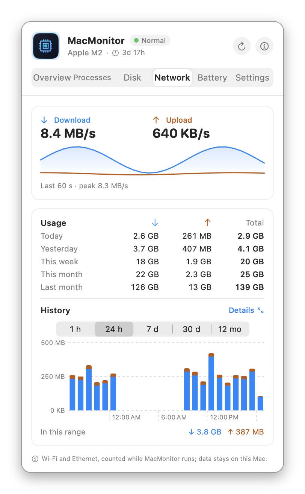
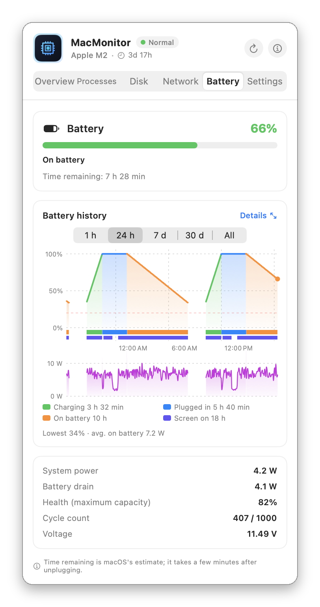
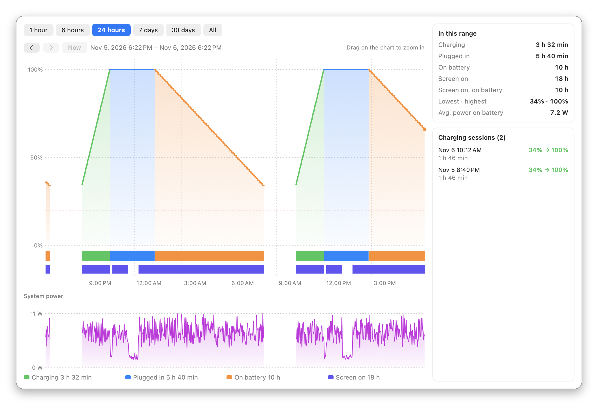
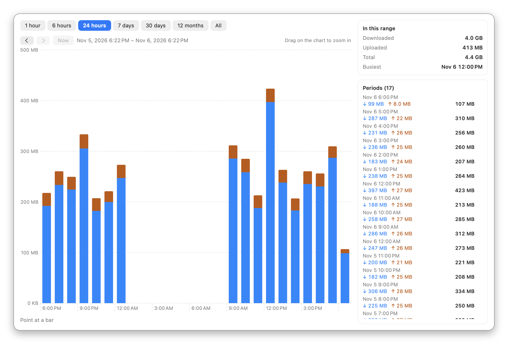

<p align="center">
  
</p>

<h1 align="center">MacMonitor</h1>

<p align="center">
  A free, open-source <b>menu bar monitor</b> for macOS: live <b>CPU</b>, <b>RAM</b> and <b>network speed</b> in the menu bar, with per-core load, memory breakdown, top processes, network speed and usage history, free disk space and battery health and history one click away.<br>
  Written in Swift with AppKit and SwiftUI; no Electron and no third-party libraries.
</p>

<p align="center">
  A lightweight, free alternative to <b>iStat Menus</b>, <b>Stats</b> and <b>MenuMeters</b> when you only need CPU, memory, network, disk and battery at a glance.
</p>

<p align="center">
  <b>🇬🇧 English</b> · <a href="README.tr.md">🇹🇷 Türkçe</a>
</p>

<p align="center">
  <a href="https://gitlab.com/freeware2/macmonitor/-/releases/permalink/latest/downloads/MacMonitor.pkg"></a>
</p>

<p align="center">
  <a href="https://macfreeware.github.io/macmonitor/">Website</a> · <a href="https://gitlab.com/freeware2/macmonitor/-/releases">All releases</a> · <a href="#download-and-install">Installation steps</a> · The interface is in English and Turkish
</p>

> [!warning] The first time you open the installer, macOS blocks it. This is expected.
> MacMonitor is free and not notarized by Apple, so when you double-click the downloaded `MacMonitor-<version>.pkg` for the first time, macOS says it *could not verify* the package and does not open it. You only need to allow it once:
>
> 1. In the warning, click **Done**. Do **not** click *Move to Trash*.
> 2. Open **System Settings ▸ Privacy & Security** and scroll down to **Security**.
> 3. Next to *"MacMonitor-&lt;version&gt;.pkg" was blocked to protect your Mac*, click **Open Anyway** and confirm with your password or Touch ID. The installer opens.
>
> Prefer Terminal? Run `xattr -d com.apple.quarantine ~/Downloads/MacMonitor-*.pkg`, then double-click the package.

## Screenshots

The readout in light and dark menu bars (red once a threshold is crossed), the panel that opens with a click, and the history windows.

<p align="center"></p>

<p align="center">
  
  &nbsp;
  
</p>

<p align="center">
  
  &nbsp;
  
</p>

<p align="center">
  
  &nbsp;
  
</p>

<p align="center">
  
</p>

<p align="center">
  
</p>

## Features

### Menu bar

- **Live CPU and RAM percentages and network speed**, refreshed every 0.5 to 5 seconds.
- **Choose what shows:** CPU, RAM and network speed can each be turned on or off.
- **Three styles:** symbols, text (`CPU 12%  RAM 48%`) or minimal (`12% · 48%`).
- **Network speed** in two small lines, download in blue over upload in orange, in MB/s or Mbit/s.
- **Alerts:** the value turns red when CPU or RAM crosses your threshold (20% to 95%; 85% for CPU and 90% for RAM by default).
- **Right-click menu:** history windows, check for updates, refresh now, open Activity Monitor, quit.
- No Dock icon: MacMonitor lives in the menu bar, and shows in the Dock only while a history window is open.

### Overview

- **CPU:** total usage split into user, system and idle, a bar for every core (efficiency and performance cores on Apple Silicon) and a 60-second history graph.
- **Memory:** used and total RAM, computed the same way as Activity Monitor and split into App, Wired, Compressed and Free/Cached, plus swap use and a 60-second history graph.
- The chip model and uptime in the header.

### Processes

- The six processes using the most **CPU** or **memory**, with name and PID.
- CPU is shown as a share of all cores, on the same scale as the menu bar total; memory is the physical footprint, as in Activity Monitor.
- Lists your own processes; system processes need administrator rights to read. A link opens Activity Monitor.

### Disk

- **Free, used and total space** for every mounted volume: the startup disk, external drives and USB sticks.
- Sizes as Finder shows them (decimal GB, purgeable space counted as free). The bar turns orange above 75% and red above 90%.
- Double-click a volume to open it in Finder.

### Network

- **Download and upload speed** right now, with a 60-second graph and its peak.
- **Usage:** data downloaded and uploaded today, yesterday, this week, this month and last month.
- **Usage chart** by minute, hour, day or month, over the last hour, 24 hours, 7 days, 30 days or 12 months. MacMonitor records once a minute, also with the panel closed, and keeps 400 days.
- Counts Wi-Fi, Ethernet and USB connections while MacMonitor runs; VPN traffic is not counted twice.

### Battery

Shown only on Macs with a battery.

- **Charge and state:** charging, on battery, fully charged or held by macOS (optimized charging), with the adapter in use.
- **Time remaining** until empty or full, as macOS estimates it.
- **Power:** what the whole Mac draws right now, in watts, and the power going into or out of the battery.
- **Health and cycles:** maximum capacity (the same figure as System Settings) and cycle count against the battery's design cycles.
- **Battery history:** a chart of the charge level colored by what the Mac was doing (charging, plugged in, on battery), with strips for the state and for when the screen was on, and system power below it, over the last hour, 24 hours, 7 days, 30 days or everything recorded. MacMonitor records once a minute, also with the panel closed, and keeps 90 days; macOS itself shows only the last 24 hours.

### History windows

**Details** on the Battery and Network tabs opens a separate, resizable window with larger charts. Move back and forward in time, or drag on a chart to zoom in. The Battery window lists every charging session and the time spent on battery, charging and with the screen on; click a session to see it on the chart. The Network window lists the figures for every period.

### Light on resources

- About **0.1% of total CPU and 40 MB of memory** with the panel closed.
- Reads everything through Darwin and Mach APIs (`host_statistics64`, `host_processor_info`, `proc_pidinfo`, `sysctl`): no `top` or `ps` shell commands, so nothing fills up the system log. The one exception runs once: `pmset -g log`, to fill in screen-on times for the existing battery history.
- Processes are scanned only while the panel is open, and disks are read only while the Disk tab is open. The battery and network histories record once a minute and write to disk every 10 minutes.

### Settings

- Refresh rate, what the menu bar shows and its style, speed in MB/s or Mbit/s, alert thresholds and red highlighting, history graphs on or off.
- **English, Turkish or the system language**, switched without restarting.
- **Launch at login** through macOS `ServiceManagement` (`SMAppService`), on by default.
- **Updates:** once a day MacMonitor checks GitLab for a new release and asks before installing it (you can turn this off). **Check for Updates…** is in the About window and the right-click menu.

## Download and install

The package runs on Apple Silicon and Intel Macs; macOS 13 or later is required.

1. Download the installer with the [download button](https://gitlab.com/freeware2/macmonitor/-/releases/permalink/latest/downloads/MacMonitor.pkg) at the top, or pick a version on the [Releases](https://gitlab.com/freeware2/macmonitor/-/releases) page.
2. Double-click `MacMonitor-<version>.pkg`. **The first time, macOS blocks it:** follow the steps below once.
3. Click through the installer. MacMonitor is installed in **Applications**, opens by itself and its readout appears in the menu bar.
4. From then on MacMonitor starts whenever you log in. You can turn this off in its Settings (*Launch automatically at login*).

Prefer no installer? Each release also has a `MacMonitor.zip`: open it and drag `MacMonitor.app` to **Applications**.

### First launch: allow the installer once

> [!important] macOS blocks the installer the first time you open it. This is expected, not a fault.
> The package is not signed with an Apple developer ID and is not notarized by Apple, so macOS cannot verify it. Allow it once:
>
> 1. **Double-click the package.** macOS says Apple could not verify it and does not open it. Click **Done**. Do **not** click *Move to Trash*.
> 2. **Open System Settings ▸ Privacy & Security** and scroll down to the **Security** section.
> 3. **Click Open Anyway** on the line saying the package was blocked, then confirm with your Mac password or Touch ID. The installer opens.
>
> Don't see *Open Anyway*? Repeat step 1: the button only appears after an attempt to open the package. On macOS 13 and 14 you can also right-click the package in the Finder and choose **Open**.

> [!tip] Using Terminal? One command does the same.
> ```bash
> xattr -d com.apple.quarantine ~/Downloads/MacMonitor-*.pkg
> ```
> It removes the quarantine flag macOS puts on files downloaded from the internet. The package then opens with a double-click as usual.

### Verifying the download

Compare the package with the SHA-256 value in the release notes:

```bash
shasum -a 256 ~/Downloads/MacMonitor-1.1.0.pkg
```

### Uninstall

Right-click the menu bar readout, choose **Quit MacMonitor**, then move MacMonitor from **Applications** to the Trash.

## Privacy

MacMonitor sends no data anywhere. Its only network connection is the update check: once a day it asks gitlab.com for the latest release, and downloads an update only when you approve it. Turn off *Check for updates automatically* in Settings and it connects only when you press **Check for Updates…**. It needs no administrator rights and no extra permissions. The battery history (charge level, charging state, screen on or off and system power, 8 bytes a minute) and the network history (amount of data per minute, not what was sent or where) stay on your Mac in `~/Library/Application Support/MacMonitor/`, as `battery-history.bin` and `network-history.bin`; delete a file to clear it.

## Building from source

Requires the Xcode command line tools (macOS 13 or later).

```bash
./build.sh              # builds build/MacMonitor.app (universal: arm64 + x86_64)
./build.sh --zip        # also build/release/MacMonitor.zip and its SHA-256
scripts/build_pkg.sh    # installer: build/release/MacMonitor-<version>.pkg and its SHA-256
./install.sh            # builds, copies to Applications and starts it
```

## FAQ

### Is MacMonitor free?

Yes. MacMonitor is free and open source under the GPL-3.0 license. There are no ads, no accounts and no in-app purchases, and it collects nothing; its only connection is the daily update check on GitLab, which you can turn off.

### How do I see CPU and RAM usage in the Mac menu bar?

Install MacMonitor: CPU and RAM percentages appear in the menu bar right away and refresh every 0.5 to 5 seconds. Click them for per-core load, the memory breakdown and the processes using the most CPU or memory.

### How do I check free disk space on my Mac?

Click MacMonitor in the menu bar and open the **Disk** tab. It shows free, used and total space for the startup disk and every external drive, calculated the same way as Finder.

### How do I check my Mac's battery health and charge history?

Open MacMonitor's **Battery** tab. It shows the charge, time remaining, power draw, battery health (the same "Maximum Capacity" as System Settings) and cycle count, and a chart of the charge level and system power over the last hour, 24 hours, 7 days, 30 days or everything recorded. macOS itself only shows the last 24 hours.

### Does MacMonitor keep a battery history when the panel is closed?

Yes. It records the battery once a minute while it runs and keeps 90 days, about 1 MB, in `~/Library/Application Support/MacMonitor` on your Mac. Nothing is sent anywhere. The Battery tab only appears on Macs with a battery.

### How do I see network speed in the Mac menu bar?

MacMonitor shows download and upload speed in two small lines next to CPU and RAM, in MB/s or Mbit/s. The **Network** tab adds usage for today, yesterday, this week, this month and last month, with charts by minute, hour, day or month, kept for 400 days.

### How do I see when my Mac was charging, and how long the screen was on?

Open **Details** in MacMonitor's **Battery** tab. The chart colors charging, plugged-in and on-battery time, with a strip for when the screen was on, and lists every charging session with its start, length and charge gained.

### Does MacMonitor update itself?

Yes, from version 1.3.0. Once a day it looks for a new release on GitLab and shows what's new. If you choose **Update Now**, it downloads the update, checks its SHA-256 and signature, replaces itself and restarts, and your battery history is kept. No password is needed. You can skip a version, or turn the check off in Settings.

### Will it slow down my Mac?

No. With the panel closed MacMonitor uses about 0.1% of total CPU and 40 MB of memory. It doesn't run shell commands such as `top` or `ps`, so it adds nothing to the system log.

### How is it different from iStat Menus or Stats?

MacMonitor does less on purpose: CPU, memory, network speed, disk space, the battery and the top processes. It has no sensor or GPU graphs. If those essentials are all you want, it stays small and quiet.

### Which Macs does it run on?

Apple Silicon and Intel Macs with macOS 13 Ventura or later.

### Why does macOS block it the first time?

MacMonitor is not notarized by Apple, which needs a paid developer account. Allow it once in **System Settings ▸ Privacy & Security ▸ Open Anyway**; see [First launch](#first-launch-allow-the-installer-once).

<sub>iStat Menus, Stats and MenuMeters are named only for comparison; MacMonitor is not affiliated with them.</sub>

## License

Copyright © 2026 Rafet SAPANCI

MacMonitor is free software: you can use, change and redistribute it under the [GNU General Public License](LICENSE), version 3 or (at your option) any later version (GPL-3.0-or-later). If you distribute changed versions, you must offer their source code under the same license. The program comes with **no warranty**; see [LICENSE](LICENSE) for details.
