<p align="center">
  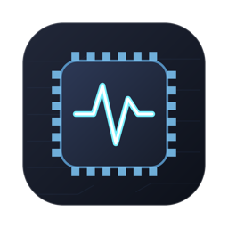
</p>

<h1 align="center">MacMonitor</h1>

<p align="center">
  macOS için ücretsiz ve açık kaynak bir <b>menü çubuğu izleyicisi</b>: menü çubuğunda canlı <b>CPU</b>, <b>RAM</b> ve <b>ağ hızı</b>; tek tıkla çekirdek yükleri, bellek dağılımı, en çok kaynak kullanan işlemler, ağ kullanım geçmişi, disk boşluğu ve pil sağlığıyla pil geçmişi.<br>
  Swift, AppKit ve SwiftUI ile yazılmıştır; Electron ya da üçüncü taraf kütüphane gerektirmez.
</p>

<p align="center">
  Yalnızca CPU, bellek, ağ, disk ve pile bir bakışta göz atmak istiyorsanız <b>iStat Menus</b>, <b>Stats</b> ve <b>MenuMeters</b>'a hafif ve ücretsiz bir alternatif.
</p>

<p align="center">
  <a href="README.md">🇬🇧 English</a> · <b>🇹🇷 Türkçe</b>
</p>

<p align="center">
  <a href="https://gitlab.com/freeware2/macmonitor/-/releases/permalink/latest/downloads/MacMonitor.pkg">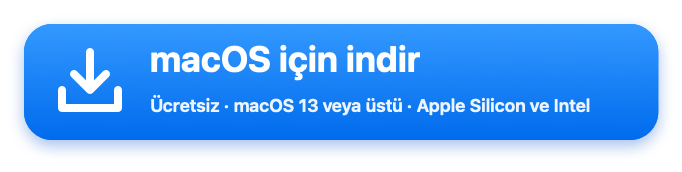</a>
</p>

<p align="center">
  <a href="https://macfreeware.github.io/tr/macmonitor/">Web sitesi</a> · <a href="https://gitlab.com/freeware2/macmonitor/-/releases">Tüm sürümler</a> · <a href="#i̇ndirme-ve-kurulum">Kurulum adımları</a> · Arayüz Türkçe ve İngilizcedir
</p>

> [!warning] Kurulum paketini ilk açtığınızda macOS onu engeller. Bu beklenen bir durumdur.
> MacMonitor ücretsizdir ve Apple onayından (notarization) geçmemiştir. Bu yüzden indirdiğiniz `MacMonitor-<sürüm>.pkg` dosyasına ilk kez çift tıkladığınızda macOS paketi *doğrulayamadığını* söyler ve açmaz. Bunu bir kez onaylamanız yeterlidir:
>
> 1. Uyarıda **Bitti**'ye tıklayın. *Çöp Sepetine Taşı*'yı **seçmeyin**.
> 2. **Sistem Ayarları ▸ Gizlilik ve Güvenlik**'i açın ve **Güvenlik** bölümüne inin.
> 3. *"MacMonitor-&lt;sürüm&gt;.pkg" Mac'inizi korumak için engellendi* satırında **Yine de Aç**'a tıklayın ve parolanız ya da Touch ID ile onaylayın. Kurulum açılır.
>
> Terminal'i mi tercih edersiniz? `xattr -d com.apple.quarantine ~/Downloads/MacMonitor-*.pkg` komutunu çalıştırıp pakete çift tıklayın.

## Ekran görüntüleri

Açık ve koyu menü çubuğunda gösterge (eşik aşılınca kırmızı), tıklayınca açılan panel ve geçmiş pencereleri.

<p align="center">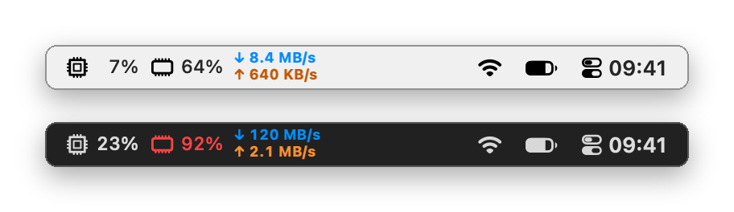</p>

<p align="center">
  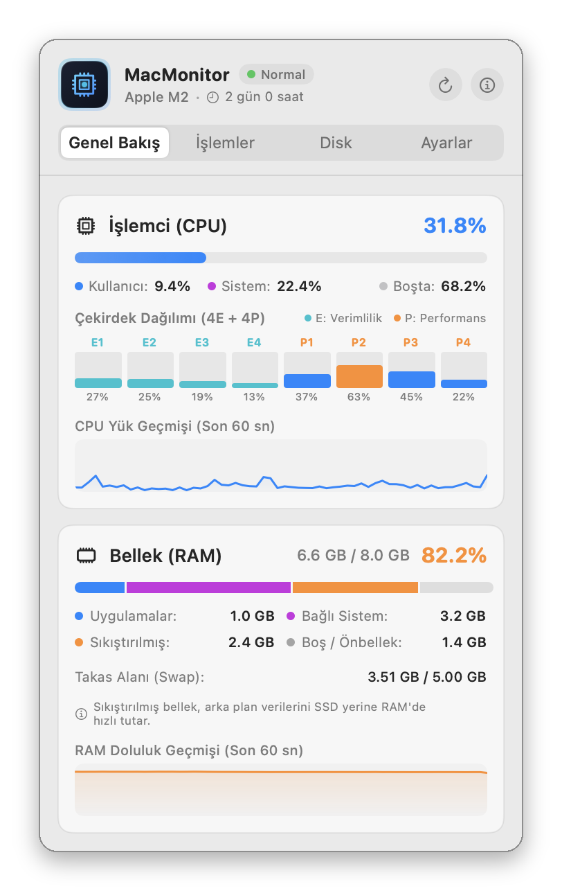
  &nbsp;
  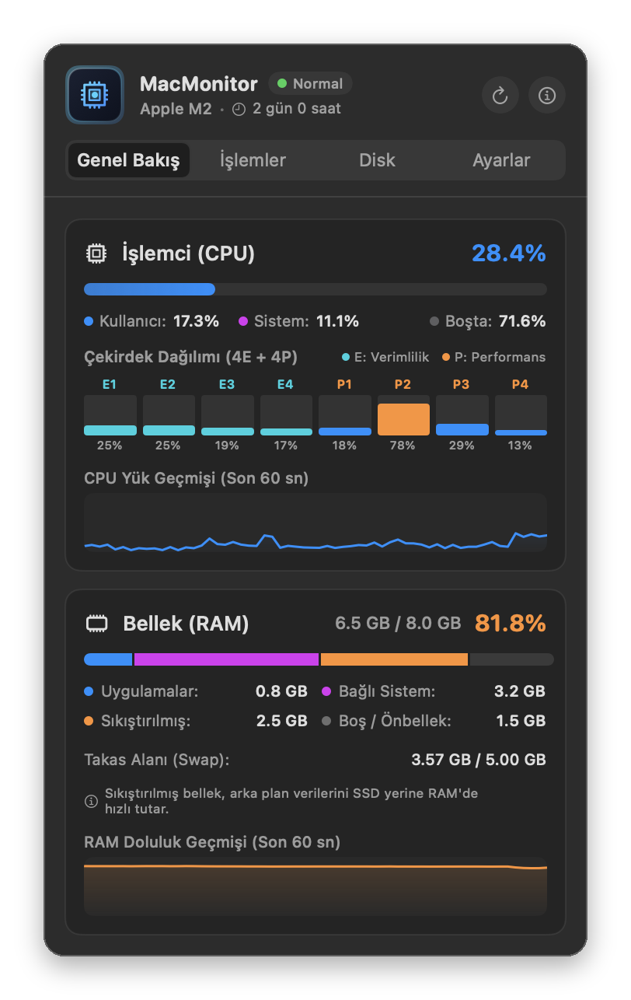
</p>

<p align="center">
  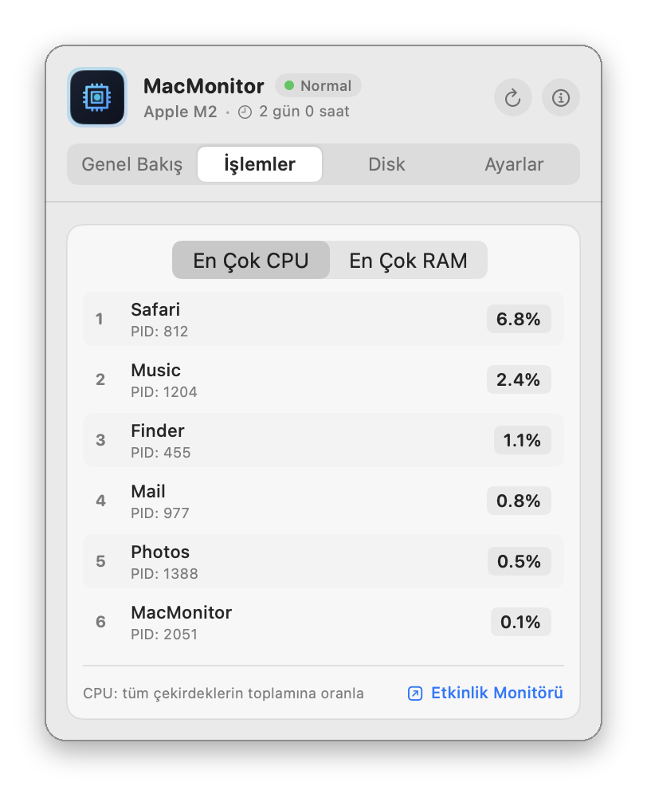
  &nbsp;
  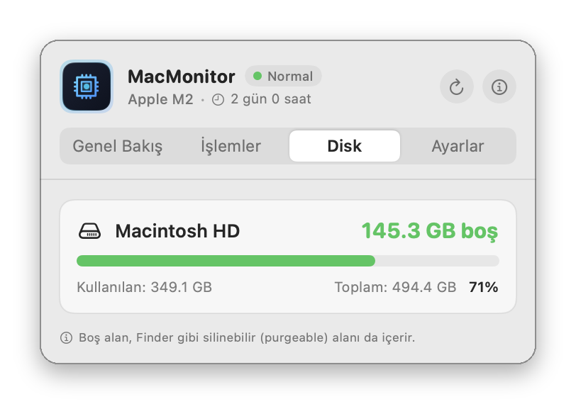
</p>

<p align="center">
  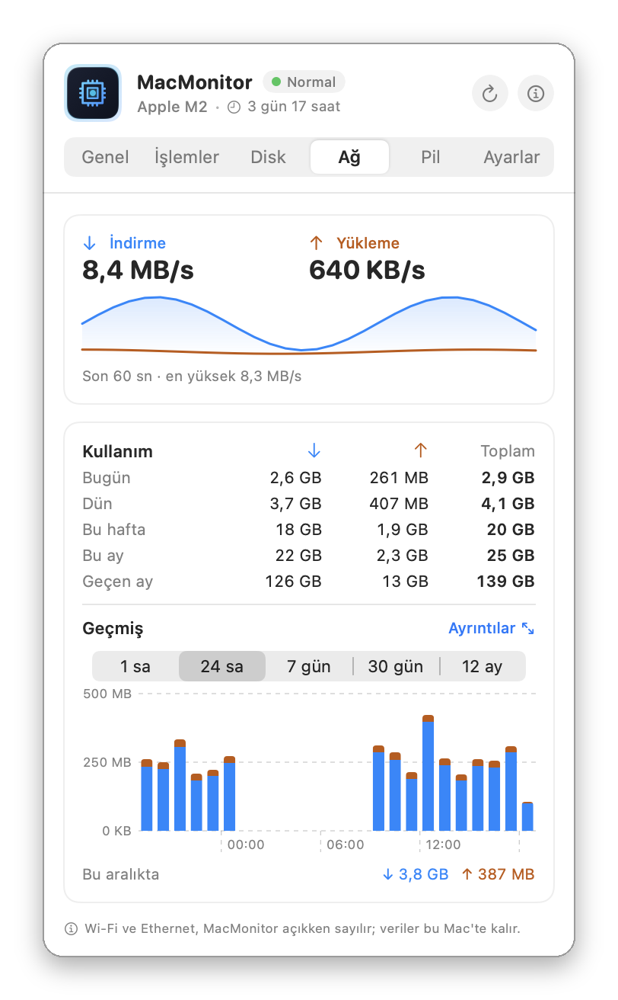
  &nbsp;
  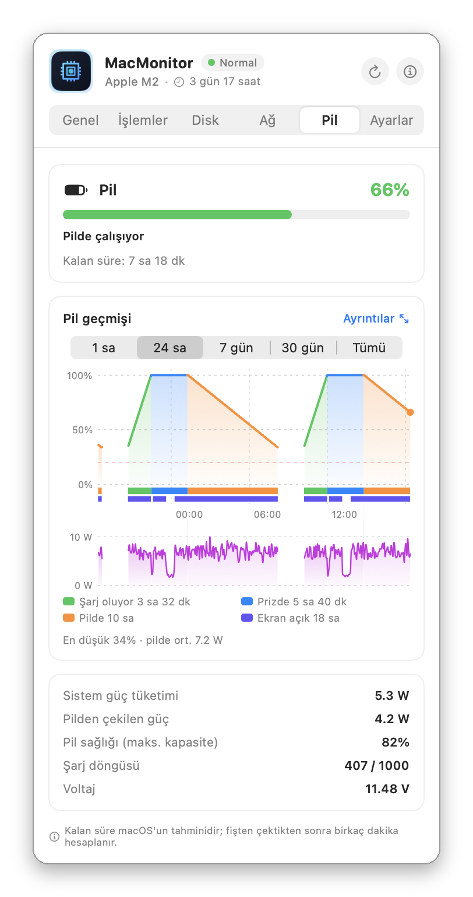
</p>

<p align="center">
  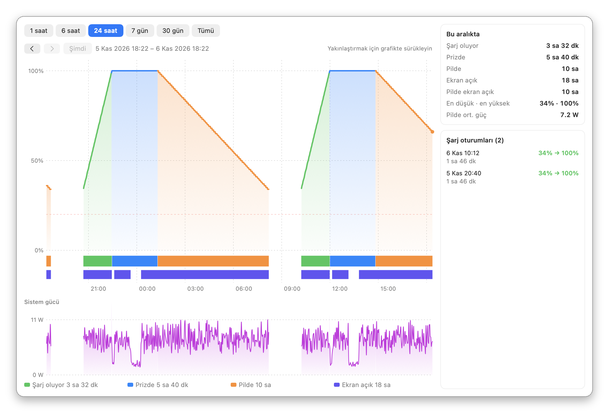
</p>

<p align="center">
  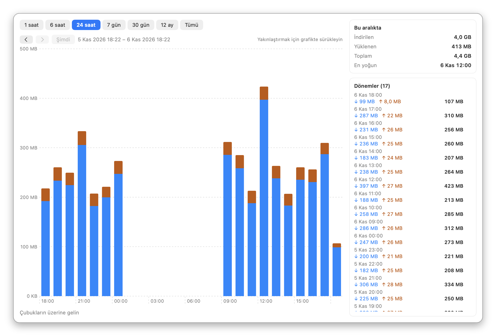
</p>

## Özellikler

### Menü çubuğu

- **Canlı CPU ve RAM yüzdeleri ve ağ hızı**, 0,5 ile 5 saniye arasında seçtiğiniz sıklıkla yenilenir.
- **Neyin görüneceğini seçin:** CPU, RAM ve ağ hızı ayrı ayrı açılıp kapatılabilir.
- **Üç görünüm:** simgeli, metinli (`CPU 12%  RAM 48%`) ya da sade (`12% · 48%`).
- **Ağ hızı** iki küçük satırda: üstte mavi indirme, altta turuncu yükleme; MB/s ya da Mbit/s.
- **Uyarılar:** CPU ya da RAM belirlediğiniz eşiği aşınca değer kırmızıya döner (%20 ile %95 arası; varsayılan CPU için %85, RAM için %90).
- **Sağ tık menüsü:** geçmiş pencereleri, güncellemeleri denetle, şimdi yenile, Etkinlik Monitörü'nü aç, çık.
- Dock'ta simgesi yoktur; MacMonitor menü çubuğunda durur, Dock'ta yalnızca bir geçmiş penceresi açıkken görünür.

### Genel Bakış

- **CPU:** kullanıcı, sistem ve boşta olarak ayrılmış toplam kullanım, her çekirdek için ayrı çubuk (Apple Silicon'da verimlilik ve performans çekirdekleri) ve 60 saniyelik geçmiş grafiği.
- **Bellek:** Etkinlik Monitörü ile aynı şekilde hesaplanan kullanılan ve toplam RAM; Uygulamalar, Bağlı, Sıkıştırılmış ve Boş/Önbellek olarak ayrılır. Takas alanı kullanımı ve 60 saniyelik geçmiş grafiği de vardır.
- Başlıkta çip modeli ve açık kalma süresi.

### İşlemler

- **CPU**'ya ya da **belleğe** göre en çok kaynak kullanan altı işlem, adı ve PID'siyle.
- CPU, menü çubuğundaki toplamla aynı ölçekte, tüm çekirdeklere oranla gösterilir; bellek, Etkinlik Monitörü'ndeki gibi fiziksel ayak izidir.
- Kendi kullanıcınızın işlemlerini listeler; sistem işlemlerini okumak yönetici yetkisi gerektirir. Bir bağlantı Etkinlik Monitörü'nü açar.

### Disk

- Bağlı her diskin **boş, kullanılan ve toplam alanı**: başlangıç diski, harici diskler ve USB bellekler.
- Boyutlar Finder'daki gibidir (ondalık GB, silinebilir alan boş sayılır). Çubuk %75'in üstünde turuncu, %90'ın üstünde kırmızı olur.
- Diske çift tıklayınca Finder'da açılır.

### Ağ

- O anki **indirme ve yükleme hızı**, 60 saniyelik grafik ve en yüksek değeriyle.
- **Kullanım:** bugün, dün, bu hafta, bu ay ve geçen ay indirilen ve yüklenen veri.
- **Kullanım grafiği:** son 1 saat, 24 saat, 7 gün, 30 gün ya da 12 ay için dakika, saat, gün ya da ay bazında. MacMonitor panel kapalıyken de dakikada bir kaydeder ve 400 gün tutar.
- MacMonitor açıkken Wi-Fi, Ethernet ve USB bağlantılarını sayar; VPN trafiği çift sayılmaz.

### Pil

Yalnızca pilli Mac'lerde görünür.

- **Şarj ve durum:** şarj oluyor, pilde, tam dolu ya da macOS tarafından bekletiliyor (optimize şarj); kullanılan adaptörle birlikte.
- macOS'un tahminiyle bitene ya da dolana kadar **kalan süre**.
- **Güç:** Mac'in o anda toplam çektiği güç (W) ve pile giren ya da pilden çekilen güç.
- **Sağlık ve döngü:** maksimum kapasite (Sistem Ayarları'ndaki değerle aynı) ve pilin tasarlandığı döngü sayısına karşı döngü sayısı.
- **Pil geçmişi:** Mac'in durumuna göre (şarj oluyor, prizde, pilde) renklenen şarj düzeyi grafiği; durum ve ekranın açık olduğu zamanlar için şeritler, altında sistem gücü. Son 1 saat, 24 saat, 7 gün, 30 gün ya da kaydedilen tüm süre için. MacMonitor panel kapalıyken de dakikada bir kaydeder ve 90 gün tutar; macOS'un kendisi yalnızca son 24 saati gösterir.

### Geçmiş pencereleri

Pil ve Ağ sekmelerindeki **Ayrıntılar**, daha büyük grafiklerle ayrı ve boyutlandırılabilir bir pencere açar. Zamanda ileri geri gidebilir ya da grafikte sürükleyerek yakınlaştırabilirsiniz. Pil penceresi her şarj oturumunu ve pilde, şarjda ve ekran açıkken geçen süreyi listeler; bir oturuma tıklayınca grafikte gösterir. Ağ penceresi her dönemin rakamlarını listeler.

### Kaynak dostu

- Panel kapalıyken **toplam CPU'nun yaklaşık %0,1'i ve 40 MB bellek**.
- Her şeyi Darwin ve Mach API'leriyle (`host_statistics64`, `host_processor_info`, `proc_pidinfo`, `sysctl`) okur; `top` ya da `ps` gibi kabuk komutları çalıştırmaz, bu yüzden sistem logunu doldurmaz. Tek istisna bir kez çalışır: mevcut pil geçmişine ekran açık sürelerini eklemek için `pmset -g log`.
- İşlemler yalnızca panel açıkken taranır, diskler yalnızca Disk sekmesi açıkken okunur. Pil ve ağ geçmişi dakikada bir kaydeder ve 10 dakikada bir diske yazar.

### Ayarlar

- Yenileme sıklığı, menü çubuğunda görünecekler ve görünüm, MB/s ya da Mbit/s hız birimi, uyarı eşikleri ve kırmızı vurgu, geçmiş grafiklerini açma/kapama.
- **Türkçe, İngilizce ya da sistem dili**, yeniden başlatmadan değişir.
- macOS `ServiceManagement` (`SMAppService`) ile **Mac açılışında otomatik başlatma**, varsayılan olarak açık.
- **Güncellemeler:** MacMonitor günde bir kez GitLab'da yeni sürüm olup olmadığına bakar ve kurmadan önce sorar (kapatılabilir). **Güncellemeleri Denetle…** Hakkında penceresinde ve sağ tık menüsünde bulunur.

## İndirme ve kurulum

Paket Apple Silicon ve Intel Mac'lerde çalışır; macOS 13 veya üstü gerekir.

1. Kurulum paketini yukarıdaki [indirme düğmesiyle](https://gitlab.com/freeware2/macmonitor/-/releases/permalink/latest/downloads/MacMonitor.pkg) indirin ya da [Sürümler](https://gitlab.com/freeware2/macmonitor/-/releases) sayfasından bir sürüm seçin.
2. `MacMonitor-<sürüm>.pkg` dosyasına çift tıklayın. **macOS ilk seferde engeller:** aşağıdaki adımları bir kez uygulayın.
3. Kurulum adımlarını tamamlayın. MacMonitor **Uygulamalar** klasörüne kurulur, kendiliğinden açılır ve göstergesi menü çubuğunda belirir.
4. Bundan sonra MacMonitor Mac her açıldığında kendiliğinden başlar. Bunu Ayarlar'dan (*Mac açılışında otomatik başlat*) kapatabilirsiniz.

Kurulum paketi istemiyor musunuz? Her sürümde bir `MacMonitor.zip` de vardır: açın ve `MacMonitor.app`'i **Uygulamalar** klasörüne sürükleyin.

### İlk açılış: kurulum paketine bir kez izin verin

> [!important] macOS kurulum paketini ilk açtığınızda engeller. Bu bir hata değil, beklenen bir durumdur.
> Paket bir Apple geliştirici kimliğiyle imzalanmamıştır ve Apple onayından geçmemiştir; bu yüzden macOS onu doğrulayamaz. Bir kez izin verin:
>
> 1. **Pakete çift tıklayın.** macOS, Apple'ın paketi doğrulayamadığını söyler ve açmaz. **Bitti**'ye tıklayın. *Çöp Sepetine Taşı*'yı **seçmeyin**.
> 2. **Sistem Ayarları ▸ Gizlilik ve Güvenlik**'i açın ve **Güvenlik** bölümüne inin.
> 3. Paketin engellendiğini söyleyen satırda **Yine de Aç**'a tıklayın, sonra Mac parolanız ya da Touch ID ile onaylayın. Kurulum açılır.
>
> *Yine de Aç* görünmüyor mu? 1. adımı tekrarlayın: düğme yalnızca paketi açma denemesinden sonra çıkar. macOS 13 ve 14'te paketi Finder'da sağ tıklayıp **Aç**'ı da seçebilirsiniz.

> [!tip] Terminal mi kullanıyorsunuz? Tek komut aynı işi yapar.
> ```bash
> xattr -d com.apple.quarantine ~/Downloads/MacMonitor-*.pkg
> ```
> macOS'un internetten indirilen dosyalara koyduğu karantina işaretini kaldırır. Paket ardından her zamanki gibi çift tıklamayla açılır.

### İndirilen dosyayı doğrulama

Paketi sürüm notlarındaki SHA-256 değeriyle karşılaştırın:

```bash
shasum -a 256 ~/Downloads/MacMonitor-1.1.0.pkg
```

### Kaldırma

Menü çubuğu göstergesine sağ tıklayıp **MacMonitor'dan Çık**'ı seçin, sonra MacMonitor'ı **Uygulamalar**'dan Çöp Sepeti'ne taşıyın.

## Gizlilik

MacMonitor hiçbir yere veri göndermez. Tek ağ bağlantısı güncelleme denetimidir: günde bir kez gitlab.com'a son sürümü sorar, güncellemeyi yalnızca siz onaylarsanız indirir. Ayarlar'dan *Güncellemeleri otomatik denetle*'yi kapatırsanız yalnızca **Güncellemeleri Denetle…** düğmesine bastığınızda bağlanır. Yönetici yetkisi ya da ek izin gerektirmez. Pil geçmişi (şarj düzeyi, şarj durumu, ekranın açık olup olmadığı ve sistem gücü; dakikada 8 bayt) ve ağ geçmişi (dakika başına veri miktarı; neyin nereye gittiği değil) Mac'inizde, `~/Library/Application Support/MacMonitor/` klasöründe `battery-history.bin` ve `network-history.bin` dosyalarında kalır; silmek için ilgili dosyayı silin.

## Kaynak koddan derleme

Xcode komut satırı araçları gerekir (macOS 13 veya üstü).

```bash
./build.sh              # build/MacMonitor.app'i derler (universal: arm64 + x86_64)
./build.sh --zip        # ayrıca build/release/MacMonitor.zip ve SHA-256 değeri
scripts/build_pkg.sh    # kurulum paketi: build/release/MacMonitor-<sürüm>.pkg ve SHA-256 değeri
./install.sh            # derler, Uygulamalar'a kopyalar ve başlatır
```

## Sık sorulan sorular

### MacMonitor ücretsiz mi?

Evet. MacMonitor, GPL-3.0 lisansıyla ücretsiz ve açık kaynaktır. Reklam, hesap ya da uygulama içi satın alma yoktur, hiçbir veri toplamaz; tek bağlantısı GitLab'daki günlük güncelleme denetimidir ve kapatılabilir.

### Mac'te menü çubuğunda CPU ve RAM kullanımını nasıl görürüm?

MacMonitor'ı kurun: CPU ve RAM yüzdeleri hemen menü çubuğunda belirir ve 0,5 ile 5 saniye arasında yenilenir. Tıklayınca çekirdek yükleri, bellek dağılımı ve en çok CPU ya da bellek kullanan işlemler açılır.

### Mac'imde ne kadar boş disk alanı kaldığını nasıl görürüm?

Menü çubuğunda MacMonitor'a tıklayıp **Disk** sekmesini açın. Başlangıç diskinin ve bağlı her harici diskin boş, kullanılan ve toplam alanını Finder ile aynı hesapla gösterir.

### Mac'imin pil sağlığını ve şarj geçmişini nasıl görürüm?

MacMonitor'ın **Pil** sekmesini açın. Şarj yüzdesini, kalan süreyi, güç tüketimini, pil sağlığını (Sistem Ayarları'ndaki "Maksimum Kapasite" ile aynı) ve döngü sayısını; son 1 saat, 24 saat, 7 gün, 30 gün ya da kaydedilen tüm süre için şarj düzeyi ve sistem gücü grafiğini gösterir. macOS'un kendisi yalnızca son 24 saati gösterir.

### Panel kapalıyken de pil geçmişi kaydediliyor mu?

Evet. MacMonitor çalıştığı sürece pili dakikada bir kaydeder ve 90 günü (yaklaşık 1 MB) Mac'inizde, `~/Library/Application Support/MacMonitor` içinde tutar. Hiçbir yere gönderilmez. Pil sekmesi yalnızca pilli Mac'lerde görünür.

### Mac menü çubuğunda ağ hızını nasıl görürüm?

MacMonitor indirme ve yükleme hızını CPU ve RAM'in yanında iki küçük satırda, MB/s ya da Mbit/s olarak gösterir. **Ağ** sekmesi bugün, dün, bu hafta, bu ay ve geçen ayın kullanımını, dakika, saat, gün ya da ay bazında grafiklerle ekler ve 400 gün saklar.

### Mac'imin ne zaman şarj olduğunu ve ekranın ne kadar açık kaldığını nasıl görürüm?

MacMonitor'ın **Pil** sekmesinde **Ayrıntılar**'ı açın. Grafik şarj, prizde ve pilde geçen süreyi renklendirir, ekranın açık olduğu zamanları bir şeritte gösterir ve her şarj oturumunu başlangıcı, süresi ve kazanılan şarjla listeler.

### MacMonitor kendini günceller mi?

Evet, 1.3.0 sürümünden itibaren. Günde bir kez GitLab'da yeni sürüme bakar ve yenilikleri gösterir. **Şimdi Güncelle**'yi seçerseniz güncellemeyi indirir, SHA-256 değerini ve imzasını denetler, kendini değiştirip yeniden başlar; pil geçmişiniz korunur. Parola gerekmez. Bir sürümü atlayabilir ya da denetimi Ayarlar'dan kapatabilirsiniz.

### Mac'imi yavaşlatır mı?

Hayır. Panel kapalıyken toplam CPU'nun yaklaşık %0,1'ini ve 40 MB bellek kullanır. `top` ya da `ps` gibi kabuk komutları çalıştırmadığı için sistem loguna bir şey eklemez.

### iStat Menus ya da Stats'tan farkı ne?

MacMonitor bilerek daha az şey yapar: CPU, bellek, ağ hızı, disk alanı, pil ve en çok kaynak kullanan işlemler. Sensör ya da GPU grafikleri yoktur. Yalnızca bu temel bilgileri istiyorsanız küçük ve sessiz kalır.

### Hangi Mac'lerde çalışır?

macOS 13 Ventura veya üstü yüklü Apple Silicon ve Intel Mac'lerde.

### macOS neden ilk seferde engelliyor?

MacMonitor, ücretli geliştirici hesabı gerektiren Apple onayından (notarization) geçmemiştir. **Sistem Ayarları ▸ Gizlilik ve Güvenlik ▸ Yine de Aç** ile bir kez izin verin; ayrıntılar [İlk açılış](#i̇lk-açılış-kurulum-paketine-bir-kez-izin-verin) bölümünde.

<sub>iStat Menus, Stats ve MenuMeters yalnızca karşılaştırma için anılmıştır; MacMonitor'ın bunlarla bir bağı yoktur.</sub>

## Lisans

Copyright © 2026 Rafet SAPANCI

MacMonitor özgür yazılımdır: [GNU Genel Kamu Lisansı](LICENSE) sürüm 3 ya da (tercihinize göre) sonraki bir sürümün koşullarıyla kullanabilir, değiştirebilir ve yeniden dağıtabilirsiniz (GPL-3.0-or-later). Değiştirilmiş sürümleri dağıtırsanız kaynak kodlarını da aynı lisansla sunmanız gerekir. Program **hiçbir garanti olmadan** sunulur; ayrıntılar için [LICENSE](LICENSE) dosyasına bakın.
